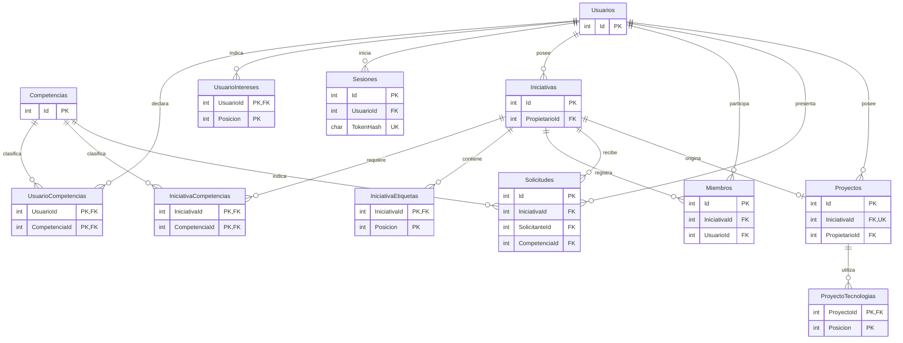
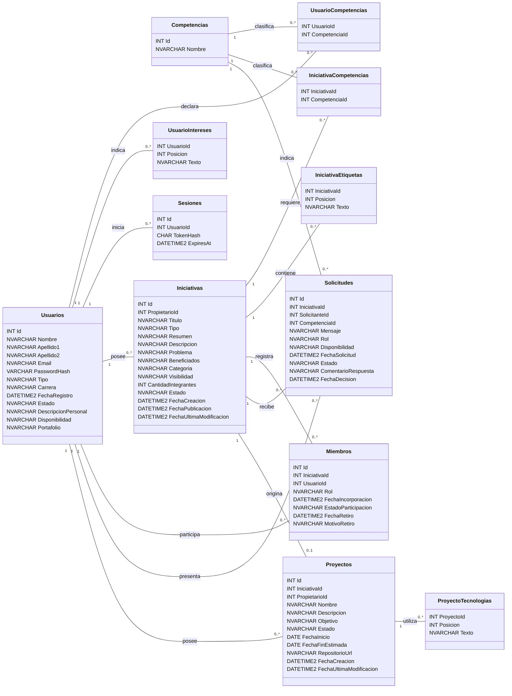

# Modelo relacional de Innovation Hub

El diseño traslada las colecciones del servidor Express del Avance 2 a SQL Server. Las entidades principales tendrán identificadores numéricos. Las listas de valores simples tendrán una fila por posición, y las listas de referencias se resolverán con llaves foráneas.

## Diagrama

| Relación | Tipo y resolución |
| --- | --- |
| Usuario–competencia | Muchos a muchos mediante `UsuarioCompetencias` y sus dos FKs. |
| Usuario–iniciativa | Uno a muchos por propiedad con `Iniciativas.PropietarioId`. Muchos a muchos por participación mediante `Miembros`, más el propietario como integrante de oficio. |
| Iniciativa–competencia | Muchos a muchos mediante `IniciativaCompetencias` y sus dos FKs. |
| Iniciativa–solicitud | Uno a muchos con `Solicitudes.IniciativaId`. |
| Proyecto–usuario | Uno a muchos de usuario a proyectos por propiedad con `Proyectos.PropietarioId`. Muchos a muchos por equipo a través de la iniciativa de origen y sus miembros activos, incluido el propietario. |
| Proyecto–iniciativa | Uno a cero o uno con la FK obligatoria y única `Proyectos.IniciativaId`. El índice único sobre esa FK refleja la regla de Express de un proyecto como máximo por iniciativa. |

### Del documento a la tabla

| Colección, arreglo o referencia de MongoDB | Destino en SQL Server | Motivo |
| --- | --- | --- |
| `usuarios` | `Usuarios` | Cada cuenta tiene su propia identidad y correo único. |
| `usuarios.competencias[]` | `UsuarioCompetencias.UsuarioId` y `CompetenciaId` | Una competencia del catálogo puede pertenecer a varios perfiles. |
| `usuarios.intereses[]` | `UsuarioIntereses` | Una fila por texto conserva la posición y admite textos repetidos. |
| `competencias` | `Competencias` | Un catálogo común para perfiles, iniciativas y solicitudes. |
| `iniciativas`, `propietarioId` | `Iniciativas`, FK `PropietarioId → Usuarios` | Una iniciativa tiene un propietario. |
| `iniciativas.competencias[]` | `IniciativaCompetencias` | Cada combinación iniciativa–competencia se guarda una vez. |
| `iniciativas.etiquetas[]` | `IniciativaEtiquetas` | Conserva texto, orden y repeticiones del arreglo. |
| `iniciativas.miembros[]` | `Miembros` activos más `Iniciativas.PropietarioId` | La lista activa se reconstruye sin duplicar al titular. |
| `iniciativas.proyectoId` | Relación inversa de `Proyectos.IniciativaId` | Una FK única representa el vínculo en ambos sentidos y evita una dependencia circular. |
| `miembros`, `iniciativaId`, `usuarioId` | `Miembros` con FKs a `Iniciativas` y `Usuarios` | La participación tiene rol, fecha y estado propios, incluidos retiros. |
| `solicitudes`, `iniciativaId`, `solicitanteId`, `competenciaId` | `Solicitudes` con FKs a `Iniciativas`, `Usuarios` y `Competencias` | Cada solicitud pertenece a una iniciativa, una persona y una competencia. |
| `solicitudes.respuesta` | `Solicitudes.Estado`, `ComentarioRespuesta`, `FechaDecision` | Hay como máximo una respuesta. Para aceptadas y rechazadas, el estado equivale a `respuesta.decision`. |
| `proyectos`, `iniciativaId`, `propietarioId` | `Proyectos` con FKs a `Iniciativas` y `Usuarios` | Cada proyecto procede de una iniciativa y mantiene su propietario. |
| `proyectos.tecnologias[]` | `ProyectoTecnologias` | Cada texto ocupa una posición. El equipo del proyecto se consulta desde la iniciativa. |
| `sesiones`, `usuarioId` | `Sesiones` con FK a `Usuarios` | Conserva el modelo de autenticación. En el corte se vuelven a emitir sesiones. |

## Tablas

`PK` indica llave primaria, `FK` foránea y `UQ` restricción de unicidad. La columna **Regla** indica la acción al eliminar el registro referenciado. Las fechas con hora usan UTC y precisión de milisegundos. La posición de los arreglos empieza en 1.

El diagrama UML muestra las columnas de las 12 tablas y sus tipos SQL base. Las tablas de abajo detallan las longitudes, la nulabilidad y las restricciones.

### Usuarios

| Columna | Tipo | ¿Obligatoria? | Llave | Regla |
| --- | --- | --- | --- | --- |
| Id | `INT IDENTITY` | Sí | PK | — |
| Nombre | `NVARCHAR(200)` | Sí | — | CHECK longitud recortada ≥ 2. |
| Apellido1 | `NVARCHAR(200)` | Sí | — | CHECK longitud recortada ≥ 2. |
| Apellido2 | `NVARCHAR(200)` | No | — | NULL o longitud recortada ≥ 2. |
| Email | `NVARCHAR(254)` | Sí | UQ | Correo normalizado; unicidad sin distinguir mayúsculas ni minúsculas. Validar formato en el servicio. |
| PasswordHash | `VARCHAR(255)` | Sí | — | Hash con algoritmo, parámetros y sal. |
| Tipo | `NVARCHAR(30)` | Sí | — | CHECK: Estudiante, Docente o Administrativo. |
| Carrera | `NVARCHAR(200)` | Sí | — | CHECK longitud recortada ≥ 2. |
| FechaRegistro | `DATETIME2(3)` | Sí | — | UTC. |
| Estado | `NVARCHAR(20)` | Sí | — | DEFAULT Activa. El servicio solo admite iniciar sesión a cuentas activas. |
| DescripcionPersonal | `NVARCHAR(MAX)` | No | — | — |
| Disponibilidad | `NVARCHAR(MAX)` | No | — | — |
| Portafolio | `NVARCHAR(MAX)` | No | — | URL HTTP(S), validada en el servicio. |

### Competencias

| Columna | Tipo | ¿Obligatoria? | Llave | Regla |
| --- | --- | --- | --- | --- |
| Id | `INT IDENTITY` | Sí | PK | — |
| Nombre | `NVARCHAR(200)` | Sí | UQ | CHECK texto no vacío. Unicidad sin distinguir mayúsculas ni minúsculas; revisar duplicados del catálogo antes de cargar. |

### UsuarioCompetencias

| Columna | Tipo | ¿Obligatoria? | Llave | Regla |
| --- | --- | --- | --- | --- |
| UsuarioId | `INT` | Sí | PK, FK → Usuarios.Id | ON DELETE CASCADE. |
| CompetenciaId | `INT` | Sí | PK, FK → Competencias.Id | ON DELETE NO ACTION. |

### UsuarioIntereses

| Columna | Tipo | ¿Obligatoria? | Llave | Regla |
| --- | --- | --- | --- | --- |
| UsuarioId | `INT` | Sí | PK, FK → Usuarios.Id | ON DELETE CASCADE. |
| Posicion | `INT` | Sí | PK | CHECK ≥ 1. |
| Texto | `NVARCHAR(MAX)` | Sí | — | CHECK texto no vacío. |

### Sesiones

| Columna | Tipo | ¿Obligatoria? | Llave | Regla |
| --- | --- | --- | --- | --- |
| Id | `INT IDENTITY` | Sí | PK | — |
| UsuarioId | `INT` | Sí | FK → Usuarios.Id | ON DELETE CASCADE. |
| TokenHash | `CHAR(64)` | Sí | UQ | SHA-256 hexadecimal del token. |
| ExpiresAt | `DATETIME2(3)` | Sí | — | El servicio exige vencimiento posterior a la hora actual. Índice para purgar vencidas mediante una tarea periódica. |

### Iniciativas

| Columna | Tipo | ¿Obligatoria? | Llave | Regla |
| --- | --- | --- | --- | --- |
| Id | `INT IDENTITY` | Sí | PK | Integra UQ (Id, PropietarioId) para la FK compuesta de Proyectos. |
| PropietarioId | `INT` | Sí | FK → Usuarios.Id | ON DELETE NO ACTION. Integra UQ (Id, PropietarioId). |
| Titulo | `NVARCHAR(MAX)` | Sí | — | CHECK longitud recortada ≥ 2. |
| Tipo | `NVARCHAR(20)` | Sí | — | CHECK: Reto, Idea o Necesidad. |
| Resumen | `NVARCHAR(MAX)` | Sí | — | CHECK longitud recortada ≥ 2. |
| Descripcion | `NVARCHAR(MAX)` | Sí | — | CHECK longitud recortada ≥ 2. |
| Problema | `NVARCHAR(MAX)` | No | — | — |
| Beneficiados | `NVARCHAR(MAX)` | No | — | — |
| Categoria | `NVARCHAR(40)` | Sí | — | CHECK: Tecnología, Educación, Sostenibilidad, Impacto social, Negocios y emprendimiento, Salud y bienestar, Cultura y creatividad u Otro. |
| Visibilidad | `NVARCHAR(20)` | Sí | — | CHECK: Pública, Institucional, Restringida o Privada. |
| CantidadIntegrantes | `INT` | Sí | — | CHECK ≥ 1. El cupo incluye al propietario. |
| Estado | `NVARCHAR(30)` | Sí | — | CHECK: Borrador, Publicada, En formación de equipo, Convertida en proyecto o Archivada. |
| FechaCreacion | `DATETIME2(3)` | Sí | — | UTC. |
| FechaPublicacion | `DATETIME2(3)` | No | — | NULL si todavía no se publicó. Si existe, CHECK ≥ FechaCreacion. |
| FechaUltimaModificacion | `DATETIME2(3)` | Sí | — | CHECK ≥ FechaCreacion. |

### IniciativaCompetencias

| Columna | Tipo | ¿Obligatoria? | Llave | Regla |
| --- | --- | --- | --- | --- |
| IniciativaId | `INT` | Sí | PK, FK → Iniciativas.Id | ON DELETE CASCADE. |
| CompetenciaId | `INT` | Sí | PK, FK → Competencias.Id | ON DELETE NO ACTION. |

### IniciativaEtiquetas

| Columna | Tipo | ¿Obligatoria? | Llave | Regla |
| --- | --- | --- | --- | --- |
| IniciativaId | `INT` | Sí | PK, FK → Iniciativas.Id | ON DELETE CASCADE. |
| Posicion | `INT` | Sí | PK | CHECK ≥ 1. |
| Texto | `NVARCHAR(MAX)` | Sí | — | CHECK texto no vacío. |

### Miembros

| Columna | Tipo | ¿Obligatoria? | Llave | Regla |
| --- | --- | --- | --- | --- |
| Id | `INT IDENTITY` | Sí | PK | — |
| IniciativaId | `INT` | Sí | FK → Iniciativas.Id | ON DELETE NO ACTION. Integra UQ (IniciativaId, UsuarioId). |
| UsuarioId | `INT` | Sí | FK → Usuarios.Id | ON DELETE NO ACTION. Integra UQ (IniciativaId, UsuarioId). |
| Rol | `NVARCHAR(MAX)` | No | — | Debe existir para nuevas incorporaciones. NULL si el arreglo legado solo trae la referencia. |
| FechaIncorporacion | `DATETIME2(3)` | No | — | Obligatoria para nuevas incorporaciones. NULL si el origen no conserva la fecha. |
| EstadoParticipacion | `NVARCHAR(10)` | Sí | — | CHECK: Activo o Retirado. |
| FechaRetiro | `DATETIME2(3)` | No | — | CHECK: obligatoria si Retirado y NULL si Activo. Si se conoce la fecha de incorporación, el retiro no puede ser anterior. |
| MotivoRetiro | `NVARCHAR(MAX)` | No | — | Solo puede tener valor si Retirado. |

### Solicitudes

| Columna | Tipo | ¿Obligatoria? | Llave | Regla |
| --- | --- | --- | --- | --- |
| Id | `INT IDENTITY` | Sí | PK | — |
| IniciativaId | `INT` | Sí | FK → Iniciativas.Id | ON DELETE NO ACTION. |
| SolicitanteId | `INT` | Sí | FK → Usuarios.Id | ON DELETE NO ACTION. |
| CompetenciaId | `INT` | Sí | FK → Competencias.Id | ON DELETE NO ACTION. |
| Mensaje | `NVARCHAR(MAX)` | Sí | — | CHECK texto no vacío. |
| Rol | `NVARCHAR(MAX)` | Sí | — | CHECK texto no vacío. |
| Disponibilidad | `NVARCHAR(MAX)` | Sí | — | CHECK texto no vacío. |
| FechaSolicitud | `DATETIME2(3)` | Sí | — | UTC. |
| Estado | `NVARCHAR(10)` | Sí | — | CHECK: Pendiente, Aceptada, Rechazada o Cancelada. Índice único filtrado sobre (IniciativaId, SolicitanteId) WHERE Estado = N'Pendiente'. |
| ComentarioRespuesta | `NVARCHAR(MAX)` | No | — | Solo puede tener valor si Aceptada o Rechazada. |
| FechaDecision | `DATETIME2(3)` | No | — | Obligatoria y ≥ FechaSolicitud si Aceptada o Rechazada; NULL si Pendiente o Cancelada. |

### Proyectos

| Columna | Tipo | ¿Obligatoria? | Llave | Regla |
| --- | --- | --- | --- | --- |
| Id | `INT IDENTITY` | Sí | PK | — |
| IniciativaId | `INT` | Sí | UQ, FK → Iniciativas.Id | Un proyecto por iniciativa. Integra la FK compuesta indicada abajo, ON DELETE NO ACTION. |
| PropietarioId | `INT` | Sí | FK → Usuarios.Id | ON DELETE NO ACTION. FK compuesta (IniciativaId, PropietarioId) → Iniciativas(Id, PropietarioId), ON DELETE NO ACTION, para garantizar el mismo titular. |
| Nombre | `NVARCHAR(MAX)` | Sí | — | CHECK longitud recortada ≥ 2. |
| Descripcion | `NVARCHAR(MAX)` | Sí | — | CHECK longitud recortada ≥ 2. |
| Objetivo | `NVARCHAR(MAX)` | Sí | — | CHECK longitud recortada ≥ 2. |
| Estado | `NVARCHAR(30)` | Sí | — | DEFAULT Planificación. Es el único estado que crea el Avance 2; inventariar cualquier valor histórico antes de acotar el catálogo. |
| FechaInicio | `DATE` | Sí | — | Fecha civil. |
| FechaFinEstimada | `DATE` | No | — | CHECK ≥ FechaInicio si existe. |
| RepositorioUrl | `NVARCHAR(MAX)` | No | — | URL HTTPS de un repositorio GitHub, validada en el servicio. |
| FechaCreacion | `DATETIME2(3)` | Sí | — | UTC. |
| FechaUltimaModificacion | `DATETIME2(3)` | Sí | — | CHECK ≥ FechaCreacion. |

### ProyectoTecnologias

| Columna | Tipo | ¿Obligatoria? | Llave | Regla |
| --- | --- | --- | --- | --- |
| ProyectoId | `INT` | Sí | PK, FK → Proyectos.Id | ON DELETE CASCADE. |
| Posicion | `INT` | Sí | PK | CHECK ≥ 1. |
| Texto | `NVARCHAR(MAX)` | Sí | — | CHECK texto no vacío. |

Las validaciones que cruzan filas quedan en el servicio transaccional. Al aceptar una solicitud, se comprueban el estado, el cupo, la cuenta activa y que el solicitante aún no integre el equipo. Las incorporaciones de una misma iniciativa deben serializarse para evitar sobrecupos. Al convertir una iniciativa, se crea el proyecto y se actualiza el estado en la misma transacción. Si la iniciativa tiene solicitudes, proyecto o participaciones históricas, se archiva. Solo se elimina físicamente cuando carece de esos vínculos.

## Plan de migración

### Paso 1 — Inventario

Todas las colecciones incluyen `_id` de tipo ObjectId. **Ref.** indica una referencia a otro documento. El inventario se basa en las escrituras de los servicios de [Express](../servidor/src/) y en la [carga de demostración](../servidor/datos/cargar-demostracion.js).

| Colección | Campos simples y objetos embebidos | Arreglos y referencias |
| --- | --- | --- |
| `usuarios` | `nombre`, `apellido1`, `apellido2`, `email`, `passwordHash`, `tipo`, `carrera`, `estado`, `fechaRegistro`, `descripcionPersonal`, `disponibilidad`, `portafolio` | `intereses[]` (texto embebido), `competencias[]` (refs. a competencias). |
| `competencias` | `nombre` | — |
| `iniciativas` | `titulo`, `tipo`, `resumen`, `descripcion`, `problema`, `beneficiados`, `categoria`, `visibilidad`, `cantidadIntegrantes`, `estado`, `fechaCreacion`, `fechaPublicacion`, `fechaUltimaModificacion` | `etiquetas[]` (texto embebido), `competencias[]` (refs. a competencias), `miembros[]` (refs. a usuarios), `propietarioId` (ref. a usuarios), `proyectoId` (ref. opcional a proyectos). |
| `miembros` | `rol`, `fechaIncorporacion`, `estadoParticipacion`, `fechaRetiro`, `motivoRetiro` | `iniciativaId` (ref. a iniciativas), `usuarioId` (ref. a usuarios). |
| `solicitudes` | `mensaje`, `rol`, `disponibilidad`, `fechaSolicitud`, `estado`, `respuesta` (objeto con `decision`, `comentario` y `fechaDecision`, o ausente/NULL) | `iniciativaId` (ref. a iniciativas), `solicitanteId` (ref. a usuarios), `competenciaId` (ref. a competencias). |
| `proyectos` | `nombre`, `descripcion`, `objetivo`, `estado`, `fechaInicio`, `fechaFinEstimada`, `repositorioUrl`, `fechaCreacion`, `fechaUltimaModificacion` | `tecnologias[]` (texto embebido), `iniciativaId` (ref. a iniciativas), `propietarioId` (ref. a usuarios). |
| `sesiones` | `tokenHash`, `expiresAt` | `usuarioId` (ref. a usuarios). |

### Paso 2 — Correspondencia

Aplicar la tabla [Del documento a la tabla](#del-documento-a-la-tabla). Normalizar campos opcionales ausentes a `NULL` y listas ausentes a cero filas. Convertir las fechas con hora a UTC y las fechas civiles de proyectos a `DATE`. Revisar variantes históricas de categoría y normalizar, por ejemplo, `Otros` a `Otro`. Registrar discrepancias entre arreglo activo y documentos de participación, referencias huérfanas, decisiones incompatibles, nombres repetidos y valores que incumplan el esquema antes de la carga definitiva.

### Paso 3 — Orden de creación

1. **Usuarios, Competencias**. No tienen FKs.
2. **UsuarioCompetencias, UsuarioIntereses, Sesiones, Iniciativas**. Solo referencian tablas del paso anterior.
3. **IniciativaCompetencias, IniciativaEtiquetas, Miembros, Solicitudes, Proyectos**. Dependen de iniciativas y, según el caso, de usuarios o competencias.
4. **ProyectoTecnologias**. Depende de proyectos.

### Paso 4 — Identificadores

En el área temporal de migración, usar una tabla de equivalencias `(Coleccion, MongoId CHAR(24), SqlId INT)` con PK `(Coleccion, MongoId)` y unicidad en `(Coleccion, SqlId)`. Al insertar cada documento, registrar su `_id` y el `Id` generado por SQL Server en la misma transacción de carga. Antes de insertar una FK, resolver el ObjectId en la colección de destino. Por ejemplo, si el ObjectId de Ana queda asociado a `Usuarios.Id = 1`, las iniciativas que la referenciaban se cargan con `PropietarioId = 1`. Si falta una equivalencia, retener el registro en el informe de incidencias hasta resolverlo. Comparar también las referencias recíprocas entre iniciativas y proyectos antes de descartar la referencia inversa del documento.

### Paso 5 — Carga de datos

Usar una exportación consistente para el ensayo. En el corte final, detener escrituras, cargar por niveles dentro de lotes transaccionales y controlar por la equivalencia qué documentos ya se migraron. Consolidar los miembros por iniciativa y usuario. Un miembro legado que solo figura en el arreglo activo conserva su participación con metadatos desconocidos en `NULL`. El dueño se toma de la iniciativa. Conservar los retiros registrados y resolver cualquier contradicción entre fuentes antes del corte. Conservar hashes de contraseña con acceso restringido y prever que el nuevo servidor pueda verificarlos antes de habilitar el acceso. Las sesiones se invalidan en el corte por decisión de diseño.

Los siguientes registros ficticios se presentan en el orden del paso 3. Los números muestran las identidades asignadas para este ejemplo. Las fechas sin hora de las columnas `DATETIME2(3)` se leen a las 00:00:00.000 UTC. `NULL` representa un valor ausente.

#### Nivel 1

**Usuarios**

| Id | Nombre | Apellido1 | Apellido2 | Email | PasswordHash | Tipo | Carrera | FechaRegistro | Estado | DescripcionPersonal | Disponibilidad | Portafolio |
| --- | --- | --- | --- | --- | --- | --- | --- | --- | --- | --- | --- | --- |
| 1 | Ana | Mora | NULL | ana@example.test | HASH_FICTICIO_1 | Estudiante | Ingeniería de software | 2026-11-01 | Activa | NULL | Tardes | NULL |
| 2 | Bruno | Vega | Rojas | bruno@example.test | HASH_FICTICIO_2 | Docente | Diseño digital | 2026-11-01 | Activa | NULL | Tardes | NULL |
| 3 | Carla | Solís | NULL | carla@example.test | HASH_FICTICIO_3 | Estudiante | Ciencia de datos | 2026-11-02 | Activa | NULL | Mañanas | NULL |

Los valores `HASH_FICTICIO_*` son marcadores para las tablas de ejemplo.

**Competencias**

| Id | Nombre |
| --- | --- |
| 1 | Diseño UX |
| 2 | JavaScript |
| 3 | Modelado relacional |
| 4 | Pruebas de software |
| 5 | Visualización de datos |

#### Nivel 2

**UsuarioCompetencias**

| UsuarioId | CompetenciaId |
| --- | --- |
| 1 | 2 |
| 1 | 3 |
| 2 | 1 |
| 2 | 4 |
| 3 | 3 |
| 3 | 5 |

**UsuarioIntereses**

| UsuarioId | Posicion | Texto |
| --- | --- | --- |
| 1 | 1 | Accesibilidad |
| 3 | 1 | Analítica |

**Sesiones**

| Id | UsuarioId | TokenHash | ExpiresAt |
| --- | --- | --- | --- |

La tabla queda vacía al corte.

**Iniciativas**

| Id | PropietarioId | Titulo | Tipo | Resumen | Descripcion | Problema | Beneficiados | Categoria | Visibilidad | CantidadIntegrantes | Estado | FechaCreacion | FechaPublicacion | FechaUltimaModificacion |
| --- | --- | --- | --- | --- | --- | --- | --- | --- | --- | --- | --- | --- | --- | --- |
| 1 | 1 | Mapa accesible del campus | Reto | Identificar rutas accesibles. | Construir un mapa de accesos y obstáculos. | La información de accesos está dispersa. | Comunidad universitaria. | Tecnología | Pública | 3 | Convertida en proyecto | 2026-11-05 | 2026-11-06 | 2026-11-12 |
| 2 | 2 | Taller de prototipado | Idea | Practicar con prototipos. | Guiar el diseño y las pruebas de un prototipo. | NULL | Estudiantes. | Educación | Institucional | 4 | Publicada | 2026-11-07 | 2026-11-08 | 2026-11-08 |
| 3 | 3 | Tablero de consumo | Necesidad | Comparar el consumo energético. | Visualizar el consumo de los edificios. | NULL | Personal administrativo. | Sostenibilidad | Restringida | 2 | Publicada | 2026-11-08 | 2026-11-09 | 2026-11-09 |

#### Nivel 3

**IniciativaCompetencias**

| IniciativaId | CompetenciaId |
| --- | --- |
| 1 | 1 |
| 1 | 2 |
| 2 | 1 |
| 2 | 4 |
| 3 | 3 |
| 3 | 5 |

**IniciativaEtiquetas**

| IniciativaId | Posicion | Texto |
| --- | --- | --- |
| 1 | 1 | accesibilidad |
| 1 | 2 | campus |
| 2 | 1 | prototipos |
| 3 | 1 | energía |

**Miembros**

| Id | IniciativaId | UsuarioId | Rol | FechaIncorporacion | EstadoParticipacion | FechaRetiro | MotivoRetiro |
| --- | --- | --- | --- | --- | --- | --- | --- |
| 1 | 1 | 2 | Diseño UX | 2026-11-10 | Activo | NULL | NULL |

Equipos activos: iniciativa 1, Ana y Bruno. Iniciativa 2, Bruno. Iniciativa 3, Carla. El proyecto 1 usa el equipo de la iniciativa 1.

**Solicitudes**

| Id | IniciativaId | SolicitanteId | CompetenciaId | Mensaje | Rol | Disponibilidad | FechaSolicitud | Estado | ComentarioRespuesta | FechaDecision |
| --- | --- | --- | --- | --- | --- | --- | --- | --- | --- | --- |
| 1 | 1 | 2 | 1 | Puedo diseñar la interfaz del mapa. | Diseño UX | Tardes | 2026-11-09 | Aceptada | Participará en el prototipo. | 2026-11-10 |
| 2 | 2 | 3 | 3 | Puedo apoyar la validación del prototipo. | Validación de datos | Mañanas | 2026-11-10 | Pendiente | NULL | NULL |

**Proyectos**

| Id | IniciativaId | PropietarioId | Nombre | Descripcion | Objetivo | Estado | FechaInicio | FechaFinEstimada | RepositorioUrl | FechaCreacion | FechaUltimaModificacion |
| --- | --- | --- | --- | --- | --- | --- | --- | --- | --- | --- | --- |
| 1 | 1 | 1 | Mapa accesible del campus | Construir un mapa de accesos y obstáculos. | Publicar un prototipo navegable. | Planificación | 2026-11-12 | 2026-12-15 | NULL | 2026-11-12 | 2026-11-12 |

#### Nivel 4

**ProyectoTecnologias**

| ProyectoId | Posicion | Texto |
| --- | --- | --- |
| 1 | 1 | React |
| 1 | 2 | SQL Server |

### Paso 6 — Verificación

- Comparar cantidades por colección contra sus tablas. Para el ejemplo se esperan 3 usuarios, 5 competencias, 3 iniciativas, 2 solicitudes, 1 proyecto y 0 sesiones. El total de miembros se obtiene al conciliar las dos fuentes y excluir a los propietarios ya representados.
- Comparar por entidad las cantidades y referencias de cada arreglo. El ejemplo tiene 6 vínculos de usuario–competencia, 6 de iniciativa–competencia, 2 intereses, 4 etiquetas y 2 tecnologías. En los arreglos de texto, cotejar también la posición.
- Comprobar que todas las referencias resuelvan por la equivalencia, que cada proyecto coincida con la iniciativa y su propietario y que los equipos reconstruidos tengan los mismos usuarios activos. Revisar retiros y decisiones por separado.
- Comparar los resultados de las [consultas](consultas.sql) y las [rutas](rutas.md) contra los ejemplos. Repetir sobre una muestra del inventario real antes del corte. Conservar la copia de origen y las equivalencias hasta aprobar el cotejo.
